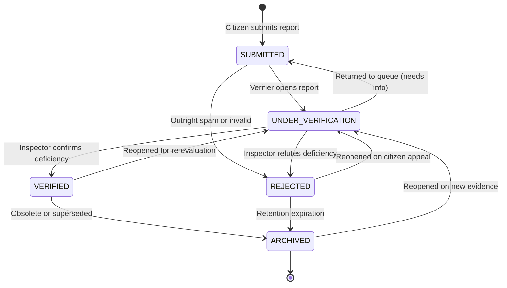
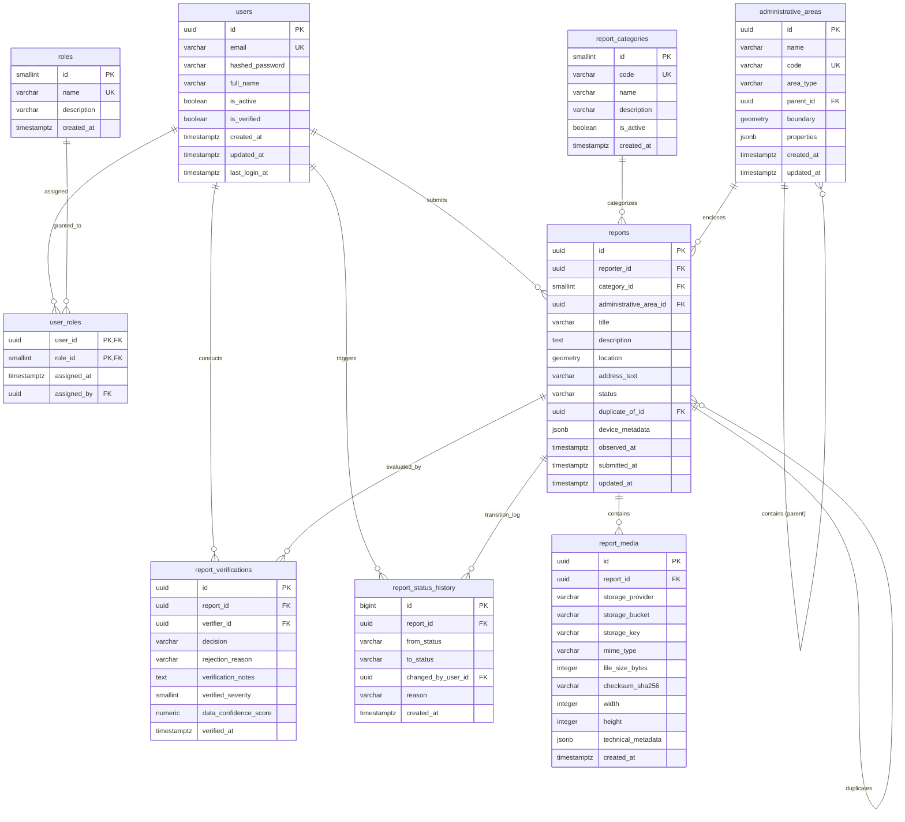

# SafeSpace Intelligence — Database Architecture Design (Phase 2, Step 1 — Final Specification)

**Document Status:** Final Architecture Specification (Approved with Corrections)  
**Target RDBMS:** PostgreSQL 17  
**Geospatial Extension:** PostGIS 3.5  
**ORM Compatibility:** SQLAlchemy 2.x (Synchronous)  
**Migration Tool:** Alembic  

---

## 1. Database Architecture Overview

SafeSpace Intelligence is a location-based public-space infrastructure auditing platform. The database architecture is designed to support high-integrity geospatial data ingestion, rigorous administrative verification workflows, and subsequent calculation of infrastructure deficiency indices without architectural bloat or premature microservices.

### Architectural Core Principles
1. **Strict Geospatial Accuracy & PostGIS Integration:** All spatial coordinates are modeled on standard geodesic reference systems (WGS 84, EPSG:4326). Points represent angular coordinates (degrees of longitude and latitude). Bounding-box and topological containment joins utilize PostGIS Generalized Search Tree (GiST) indexing with boundary-inclusive spatial operators (`ST_Covers`). Metric-distance calculations leverage explicit geography casting or functional geography indexing.
2. **Domain Separation of Concerns:** Core entities are divided into four clear domains:
   - **Identity and Access Management (IAM)**
   - **Geospatial Foundation**
   - **Infrastructure Reporting**
   - **Verification and Moderation**
3. **Decoupled SDI Scoring Architecture:**
   - **Deficiency Taxonomy (`report_categories`):** Purely defines the real-world types of defects (lighting, walkways, sightlines, assistance facilities, maintenance). It owns **zero** scoring weights.
   - **SDI Scoring Configuration (Future Stage):** Stored in versioned configuration tables (`scoring_configurations`, `area_scores`, `score_components`) implemented in the intelligence engine phase. Methodologies can evolve over time without altering historical category definitions or losing scoring reproducibility.
4. **Decoupled Operational Concepts:** The schema establishes clear boundaries between:
   - **Safety Deficiency Index (SDI):** An objective measure of physical infrastructure deficiency (e.g., failed luminaires, fractured sidewalks, blocked sightlines, missing emergency assistance points).
   - **Data Confidence:** A measurement of evidence reliability and completeness (e.g., photo clarity, GPS accuracy, corroborating reports).
   - **Inspection Priority:** An operational workflow score determining where municipal inspectors should be dispatched first.
   > [!IMPORTANT]
   > The platform strictly separates infrastructure deficiency metrics from criminal justice, crime statistics, or personal safety profiling. The database schema contains no crime data, no demographic profiling data, and must never be interpreted or exposed as a crime prediction or personal safety probability tool.
5. **Scoped Initial Lifecycle & Deferred Maintenance:**
   - The initial database schema strictly focuses on the ingestion and verification lifecycle: `SUBMITTED`, `UNDER_VERIFICATION`, `VERIFIED`, `REJECTED`, and `ARCHIVED`.
   - Maintenance work orders, contractor assignments, assignment history, and execution states (`ASSIGNED`, `IN_PROGRESS`, `RESOLVED`) are explicitly deferred to a subsequent dedicated maintenance workflow phase.
6. **Audit Data Retention & Immutability:**
   - Hard deletion of reports is strictly prevented. Foreign keys from audit tables (`report_verifications`, `report_status_history`, and `report_media`) to `reports` use `ON DELETE RESTRICT` actions to prevent cascading deletion from destroying historical public audit records.
7. **Privacy by Design:**
   - Exact coordinates are retained internally for municipal work orders. Public APIs apply coordinate coarsening (snapping to a 50-meter grid or centroid display) and strictly withhold citizen reporter identities.
   - Initial media releases support **image uploads only**. Raw EXIF data is stripped prior to storage; only an allowlisted set of non-sensitive technical tags is persisted. Device metadata is strictly constrained by an allowlist.
8. **Storage Separation:** Image binaries are strictly excluded from the database. The database stores only immutable object storage references (`storage_provider`, `storage_bucket`, `storage_key`), technical metadata, and cryptographic SHA-256 checksums.

---

## 2. Domain Boundaries

```
┌────────────────────────────────────────────────────────────────────────┐
│                   Domain 1: Identity & Access (IAM)                    │
│   [users] ────────────< [user_roles] >──────────── [roles]             │
└──────────────────┬─────────────────────────────────┬───────────────────┘
                   │ 1:N (reporter)                  │ 1:N (verifier)
                   ▼                                 ▼
┌──────────────────────────────────────┐  ┌──────────────────────────────┐
│  Domain 3: Infrastructure Reporting  │  │ Domain 4: Verification & Mod │
│  [report_categories]                 │  │ [report_verifications]       │
│  (Pure Taxonomy, No Weights)         │  │ (Append-Only Audit Log)      │
│          ▲ 1:N                       │  │          ▲ 1:N               │
│          │                           │  │          │                   │
│      [reports] ──────────────────────┼──┴──────────┘                   │
│          │ 1:N                       │  │                              │
│          ▼                           │  │ [report_status_history]      │
│   [report_media]                     │  │ (Append-Only Transition Log) │
└──────────┬───────────────────────────┘  └──────────────────────────────┘
           │ N:1 (ST_Covers spatial link)
           ▼
┌────────────────────────────────────────────────────────────────────────┐
│                     Domain 2: Geospatial Foundation                    │
│   [administrative_areas] (Wards, Districts, Municipal Boundaries)     │
└────────────────────────────────────────────────────────────────────────┘
```

### Domain 1: Identity and Access Management (IAM)
- **Scope:** Manages user accounts, authentication credentials (password hashes), verification state, and multi-role assignments.
- **Boundaries:** Does not track report contents or spatial details. Users interact with the reporting system as authors, verifiers, or system administrators through foreign keys.

### Domain 2: Geospatial Foundation
- **Scope:** Manages administrative jurisdictions (municipalities, districts, wards) and spatial boundary polygons.
- **Boundaries:** Independent of individual citizen complaints. Provides the spatial containment fabric against which reports are aggregated and future SDI metrics are computed.

### Domain 3: Infrastructure Reporting
- **Scope:** Captures raw citizen observations, deficiency classifications, geospatial point coordinates, and attached photographic evidence metadata.
- **Boundaries:** Records observation facts as submitted by citizens. Does not alter its own state without recorded verification actions. Reverse-geocoding is decoupled and handled asynchronously.

### Domain 4: Verification and Moderation
- **Scope:** Records the verification decisions made by authorized inspectors, duplicate linking, severity assessments, evidence data confidence scores, and the complete immutable history of report status transitions.
- **Boundaries:** Purely operational and auditable. State transitions are governed by a robust Service-Layer Finite State Machine (FSM) executed inside database transactions.

---

## 3. Complete Entity Inventory

| # | Entity Name | Domain | Primary Responsibility |
|---|---|---|---|
| 1 | `users` | IAM | Stores registered citizen and personnel accounts, auth credentials, verification state, and operational status. |
| 2 | `roles` | IAM | Defines system personas (`citizen`, `verifier`, `maintenance`, `admin`). |
| 3 | `user_roles` | IAM | Junction entity enabling Many-to-Many assignment of roles to users with assignment audit timestamps. |
| 4 | `administrative_areas` | Geospatial | Stores polygonal boundaries of municipal jurisdictions (wards, districts) using PostGIS geometries. |
| 5 | `report_categories` | Reporting | Standardized taxonomy of infrastructure deficiency types (lighting, sidewalk, visibility, public assistance, maintenance). |
| 6 | `reports` | Reporting | The central observational record containing deficiency details, direct point geometry, status, and reporter link. |
| 7 | `report_media` | Reporting | External object storage references and technical metadata (dimensions, hash, MIME type) for photographic evidence. |
| 8 | `report_verifications` | Verification | Append-only verification log capturing inspector decisions, verified severity (1–5), and evidence data confidence (0.00–1.00). |
| 9 | `report_status_history` | Verification | Append-only ledger recording every status transition, the initiating user/actor, timestamps, and reason. |

---

## 4. Detailed Table Definitions with Columns and Data Types

### 4.1. Domain 1: Identity and Access Management

#### 4.1.1. `roles`
Defines available system personas. Roles are static and seeded at deployment.

| Column | Data Type | Nullable | Default | Description |
|---|---|---|---|---|
| `id` | `SMALLINT` | No | Generated Always as Identity | Primary Key. |
| `name` | `VARCHAR(50)` | No | None | Unique role name (`citizen`, `verifier`, `maintenance`, `admin`). |
| `description` | `VARCHAR(255)` | No | None | Human-readable explanation of permissions. |
| `created_at` | `TIMESTAMPTZ` | No | `CURRENT_TIMESTAMP` | System creation timestamp. |

#### 4.1.2. `users`
Stores user identity, security attributes, and account lifecycle state.

| Column | Data Type | Nullable | Default | Description |
|---|---|---|---|---|
| `id` | `UUID` | No | `gen_random_uuid()` | Primary Key (non-sequential, secure identifier). |
| `email` | `VARCHAR(255)` | No | None | Unique user email address (stored lowercased). |
| `hashed_password` | `VARCHAR(255)` | No | None | Argon2id or bcrypt password hash string. |
| `full_name` | `VARCHAR(150)` | No | None | User's full name. |
| `is_active` | `BOOLEAN` | No | `TRUE` | Whether the account is active or suspended. |
| `is_verified` | `BOOLEAN` | No | `FALSE` | Email address verification status. |
| `created_at` | `TIMESTAMPTZ` | No | `CURRENT_TIMESTAMP` | Account registration timestamp. |
| `updated_at` | `TIMESTAMPTZ` | No | `CURRENT_TIMESTAMP` | Timestamp of last record update. |
| `last_login_at` | `TIMESTAMPTZ` | Yes | `NULL` | Timestamp of last successful authentication. |

#### 4.1.3. `user_roles`
Composite junction table managing Many-to-Many role memberships.

| Column | Data Type | Nullable | Default | Description |
|---|---|---|---|---|
| `user_id` | `UUID` | No | None | Foreign Key referencing `users(id)`. |
| `role_id` | `SMALLINT` | No | None | Foreign Key referencing `roles(id)`. |
| `assigned_at` | `TIMESTAMPTZ` | No | `CURRENT_TIMESTAMP` | When the role was granted. |
| `assigned_by` | `UUID` | Yes | `NULL` | Foreign Key referencing `users(id)` (administrator who granted the role). |

---

### 4.2. Domain 2: Geospatial Foundation

#### 4.2.1. `administrative_areas`
Hierarchical geographical boundaries (municipalities, districts, wards) used for spatial filtering, SDI aggregation, and municipal jurisdiction routing.

| Column | Data Type | Nullable | Default | Description |
|---|---|---|---|---|
| `id` | `UUID` | No | `gen_random_uuid()` | Primary Key. |
| `name` | `VARCHAR(150)` | No | None | Human-readable name (e.g., "Ward 14 - Central Corridor"). |
| `code` | `VARCHAR(50)` | No | None | Unique official municipal identifier code. |
| `area_type` | `VARCHAR(50)` | No | None | Type of boundary (`municipality`, `district`, `ward`, `zone`). |
| `parent_id` | `UUID` | Yes | `NULL` | Self-referencing FK to `administrative_areas(id)` for tree hierarchy. |
| `boundary` | `geometry(MultiPolygon, 4326)` | No | None | 2D MultiPolygon boundary in WGS 84 coordinate space. |
| `properties` | `JSONB` | No | `'{}'::jsonb` | Extensible administrative metadata (e.g. population, contact info). |
| `created_at` | `TIMESTAMPTZ` | No | `CURRENT_TIMESTAMP` | Ingestion timestamp. |
| `updated_at` | `TIMESTAMPTZ` | No | `CURRENT_TIMESTAMP` | Last modification timestamp. |

---

### 4.3. Domain 3: Infrastructure Reporting

#### 4.3.1. `report_categories`
Taxonomy of infrastructure deficiencies audited by the platform. Pure taxonomy—contains **no scoring weights**.

| Column | Data Type | Nullable | Default | Description |
|---|---|---|---|---|
| `id` | `SMALLINT` | No | Generated Always as Identity | Primary Key. |
| `code` | `VARCHAR(50)` | No | None | Machine-readable slug (`STREET_LIGHTING`, `PEDESTRIAN_PATHWAYS`, `VISIBILITY`, `PUBLIC_ASSISTANCE`, `MAINTENANCE`). |
| `name` | `VARCHAR(100)` | No | None | Display title for citizens and inspectors. |
| `description` | `VARCHAR(500)` | No | None | Detailed criteria defining this deficiency type. |
| `is_active` | `BOOLEAN` | No | `TRUE` | Whether this category is open for new citizen submissions. |
| `created_at` | `TIMESTAMPTZ` | No | `CURRENT_TIMESTAMP` | Creation timestamp. |

##### Baseline Category Taxonomy
1. `STREET_LIGHTING`: Poor or non-functional street lighting, dark corridors, broken luminaires.
2. `PEDESTRIAN_PATHWAYS`: Damaged pedestrian pathways, fractured sidewalks, missing curb ramps, hazardous obstructions.
3. `VISIBILITY`: Obstructed public-space visibility, overgrown vegetation, blind corners, missing safety mirrors.
4. `PUBLIC_ASSISTANCE`: Missing public assistance facilities, non-functional emergency call boxes, absent aid signage, lack of designated emergency help points.
5. `MAINTENANCE`: Poor public-space maintenance, broken street furniture, open drainage, hazardous littering, vandalized public facilities.

#### 4.3.2. `reports`
Core observation record submitted by citizens.

| Column | Data Type | Nullable | Default | Description |
|---|---|---|---|---|
| `id` | `UUID` | No | `gen_random_uuid()` | Primary Key. |
| `reporter_id` | `UUID` | No | None | Foreign Key referencing `users(id)` (authenticated citizen). |
| `category_id` | `SMALLINT` | No | None | Foreign Key referencing `report_categories(id)`. |
| `administrative_area_id`| `UUID` | Yes | `NULL` | Foreign Key referencing `administrative_areas(id)` (cached via `ST_Covers`). |
| `title` | `VARCHAR(150)` | No | None | Concise title summarizing the deficiency. |
| `description` | `TEXT` | No | None | Detailed citizen description of the defect. |
| `location` | `geometry(Point, 4326)` | No | None | PostGIS Point geometry (Longitude, Latitude) in WGS 84. |
| `address_text` | `VARCHAR(255)` | Yes | `NULL` | Reverse-geocoded street address, populated asynchronously. |
| `status` | `VARCHAR(30)` | No | `'SUBMITTED'` | Lifecycle state (Scoped initial FSM: `SUBMITTED`, `UNDER_VERIFICATION`, `VERIFIED`, `REJECTED`, `ARCHIVED`). |
| `duplicate_of_id` | `UUID` | Yes | `NULL` | Self-referencing FK to `reports(id)` if flagged as duplicate. |
| `device_metadata` | `JSONB` | No | `'{}'::jsonb` | Strictly allowlisted client data (`client_app_version`, `platform`, `os_version`, `gps_horizontal_accuracy_meters`). |
| `observed_at` | `TIMESTAMPTZ` | No | None | Citizen-asserted time of observation. |
| `submitted_at` | `TIMESTAMPTZ` | No | `CURRENT_TIMESTAMP` | System ingestion timestamp. |
| `updated_at` | `TIMESTAMPTZ` | No | `CURRENT_TIMESTAMP` | Last update timestamp. |

##### `device_metadata` Strict Allowlist
To safeguard citizen device privacy, the ingestion layer enforces a strict JSON schema allowlist:
- `client_app_version`: `string` (e.g., `"1.0.4"`)
- `platform`: `string` (`"ios"` | `"android"` | `"web"`)
- `os_version`: `string` (e.g., `"iOS 18.1"`, `"Android 15"`)
- `gps_horizontal_accuracy_meters`: `number` (e.g., `4.5`)

> [!CAUTION]
> Hardware identifiers (IMEI, MAC address, advertising ID), SIM details, and persistent device fingerprinting tokens are strictly prohibited from being accepted or stored.

#### 4.3.3. `report_media`
Metadata and references to externally stored image files. Video files are excluded from the initial release.

| Column | Data Type | Nullable | Default | Description |
|---|---|---|---|---|
| `id` | `UUID` | No | `gen_random_uuid()` | Primary Key. |
| `report_id` | `UUID` | No | None | Foreign Key referencing `reports(id)`. |
| `storage_provider` | `VARCHAR(30)` | No | `'s3'` | Object storage service identifier (`s3`, `gcs`, `minio`, `local`). |
| `storage_bucket` | `VARCHAR(63)` | No | None | Name of external object storage bucket/container. |
| `storage_key` | `VARCHAR(512)` | No | None | Object key/path in bucket (e.g., `reports/2026/11/uuid.webp`). |
| `mime_type` | `VARCHAR(100)` | No | None | Media format (`image/jpeg`, `image/png`, `image/webp`). |
| `file_size_bytes` | `INTEGER` | No | None | File size in bytes (max 15 MB). |
| `checksum_sha256` | `VARCHAR(64)` | No | None | Cryptographic SHA-256 hash (64 hex characters) for integrity and deduplication. |
| `width` | `INTEGER` | Yes | `NULL` | Image width in pixels ($> 0$). |
| `height` | `INTEGER` | Yes | `NULL` | Image height in pixels ($> 0$). |
| `technical_metadata` | `JSONB` | No | `'{}'::jsonb` | Allowlisted, non-sensitive technical metadata (e.g., orientation, color space). |
| `created_at` | `TIMESTAMPTZ` | No | `CURRENT_TIMESTAMP` | Upload timestamp. |

##### `technical_metadata` Allowlist & EXIF Sanitization
Raw EXIF blobs are completely stripped at ingestion. Only non-identifying technical metadata is extracted and persisted:
- `orientation`: `integer` (1 to 8 EXIF orientation code for rendering correction)
- `color_space`: `string` (`"sRGB"`, `"Display P3"`)
- `has_alpha`: `boolean`

> [!CAUTION]
> Camera serial numbers, lens IDs, device model identifiers, and precise EXIF GPS timestamps/coordinates are scrubbed before storage and never persisted.

---

### 4.4. Domain 4: Verification and Moderation

#### 4.4.1. `report_verifications`
Append-only log of verification evaluations. Each inspection generates a new record, preserving complete historical audits.

| Column | Data Type | Nullable | Default | Description |
|---|---|---|---|---|
| `id` | `UUID` | No | `gen_random_uuid()` | Primary Key. |
| `report_id` | `UUID` | No | None | Foreign Key referencing `reports(id)`. |
| `verifier_id` | `UUID` | No | None | Foreign Key referencing `users(id)` (personnel performing review). |
| `decision` | `VARCHAR(30)` | No | None | Outcome (`VERIFIED`, `REJECTED`, `FLAGGED`, `MARKED_DUPLICATE`). |
| `rejection_reason` | `VARCHAR(50)` | Yes | `NULL` | Standardized reason code if rejected (`SPAM`, `NOT_INFRASTRUCTURE`, `INSUFFICIENT_EVIDENCE`, `DUPLICATE`). |
| `verification_notes` | `TEXT` | Yes | `NULL` | Professional notes from inspector detailing findings. |
| `verified_severity` | `SMALLINT` | Yes | `NULL` | Inspector-assessed severity rating on a 1–5 scale (Required if `decision = 'VERIFIED'`). |
| `data_confidence_score`| `NUMERIC(3, 2)` | Yes | `NULL` | Objective metric (0.00–1.00) measuring evidence reliability & completeness. |
| `verified_at` | `TIMESTAMPTZ` | No | `CURRENT_TIMESTAMP` | Timestamp when the verification decision was committed. |

#### 4.4.2. `report_status_history`
Append-only historical audit trail tracking every lifecycle state change.

| Column | Data Type | Nullable | Default | Description |
|---|---|---|---|---|
| `id` | `BIGINT` | No | Generated Always as Identity | Primary Key (monotonically increasing sequence). |
| `report_id` | `UUID` | No | None | Foreign Key referencing `reports(id)`. |
| `from_status` | `VARCHAR(30)` | Yes | `NULL` | Previous lifecycle status (`NULL` allowed ONLY for initial transition to `SUBMITTED`). |
| `to_status` | `VARCHAR(30)` | No | None | New lifecycle status. |
| `changed_by_user_id` | `UUID` | Yes | `NULL` | Foreign Key referencing `users(id)` (null for automated system jobs). |
| `reason` | `VARCHAR(255)` | Yes | `NULL` | Operational justification for the status update. |
| `created_at` | `TIMESTAMPTZ` | No | `CURRENT_TIMESTAMP` | Immutable timestamp when transition occurred. |

---

## 5. Primary and Foreign Keys

### Primary Keys
- `roles.id`: `SMALLINT` (Identity)
- `users.id`: `UUID` (Generated via `gen_random_uuid()`)
- `user_roles.(user_id, role_id)`: Composite Primary Key
- `administrative_areas.id`: `UUID` (Generated via `gen_random_uuid()`)
- `report_categories.id`: `SMALLINT` (Identity)
- `reports.id`: `UUID` (Generated via `gen_random_uuid()`)
- `report_media.id`: `UUID` (Generated via `gen_random_uuid()`)
- `report_verifications.id`: `UUID` (Generated via `gen_random_uuid()`)
- `report_status_history.id`: `BIGINT` (Identity)

### Foreign Key Constraints & Referential Integrity Actions

| Source Table | Source Column | Target Table | Target Column | On Delete Action | On Update Action | Rationale |
|---|---|---|---|---|---|---|
| `user_roles` | `user_id` | `users` | `id` | `CASCADE` | `CASCADE` | Role mappings clean up if user record is removed. |
| `user_roles` | `role_id` | `roles` | `id` | `RESTRICT` | `CASCADE` | Prevents deleting a role that has active users. |
| `user_roles` | `assigned_by` | `users` | `id` | `SET NULL` | `CASCADE` | Preserves role assignment if grantor account is modified. |
| `administrative_areas` | `parent_id` | `administrative_areas` | `id` | `RESTRICT` | `CASCADE` | Prevents breaking hierarchical area tree. |
| `reports` | `reporter_id` | `users` | `id` | `RESTRICT` | `CASCADE` | Prevents deleting user from destroying public audit records. |
| `reports` | `category_id` | `report_categories` | `id` | `RESTRICT` | `CASCADE` | Prevents deleting active deficiency category. |
| `reports` | `administrative_area_id`| `administrative_areas` | `id` | `SET NULL` | `CASCADE` | Preserves report if administrative boundary is reorganized. |
| `reports` | `duplicate_of_id` | `reports` | `id` | `SET NULL` | `CASCADE` | Preserves duplicate report if canonical report is modified. |
| `report_media` | `report_id` | `reports` | `id` | `RESTRICT` | `CASCADE` | **Audit Protection:** Prevents hard deletion of report from destroying media references. |
| `report_verifications` | `report_id` | `reports` | `id` | `RESTRICT` | `CASCADE` | **Audit Protection:** Prevents deletion of report from destroying verification history. |
| `report_verifications` | `verifier_id` | `users` | `id` | `RESTRICT` | `CASCADE` | Prevents deletion of inspector account from destroying inspection proof. |
| `report_status_history`| `report_id` | `reports` | `id` | `RESTRICT` | `CASCADE` | **Audit Protection:** Prevents deletion of report from destroying state transition log. |
| `report_status_history`| `changed_by_user_id` | `users` | `id` | `SET NULL` | `CASCADE` | Preserves audit record if actor account is anonymized. |

> [!IMPORTANT]
> `ON DELETE RESTRICT` is explicitly configured on `report_verifications.report_id`, `report_status_history.report_id`, and `report_media.report_id`. Normal hard deletion of reports is structurally blocked. Audit and evidence records are permanently protected from accidental cascading destruction.

---

## 6. Relationships and Cardinalities

1. **`users` to `roles` (Many-to-Many via `user_roles`):**
   - **Cardinality:** $N : M$.
   - **Semantics:** A user can possess multiple roles simultaneously (e.g., a city employee can be a `citizen` submitting reports off-duty and a `verifier` or `maintenance` worker during shifts).
2. **`administrative_areas` to `administrative_areas` (One-to-Many Recursive):**
   - **Cardinality:** $1 : N$ (optional parent).
   - **Semantics:** Models geographic administrative hierarchies (e.g., a `municipality` contains multiple `districts`, which each contain multiple `wards`).
3. **`users` to `reports` (One-to-Many):**
   - **Cardinality:** $1 : N$.
   - **Semantics:** An authenticated citizen user can author zero or many reports over time. Each report is linked to exactly one user author (`reporter_id NOT NULL`).
4. **`report_categories` to `reports` (One-to-Many):**
   - **Cardinality:** $1 : N$.
   - **Semantics:** A report belongs to exactly one primary category, providing deterministic weighting for SDI aggregation.
5. **`administrative_areas` to `reports` (One-to-Many):**
   - **Cardinality:** $1 : N$ (optional foreign key).
   - **Semantics:** A report geographically falls within an administrative area. This relationship is resolved spatially using PostGIS `ST_Covers` and cached in `reports.administrative_area_id`.
6. **`reports` to `reports` (One-to-Many Self-Reference for Duplicates):**
   - **Cardinality:** $1 : N$ (optional self-reference).
   - **Semantics:** Secondary reports reporting the same defect point to the primary canonical report via `duplicate_of_id`.
7. **`reports` to `report_media` (One-to-Many):**
   - **Cardinality:** $1 : N$.
   - **Semantics:** A report includes zero, one, or multiple photographic evidence uploads.
8. **`reports` to `report_verifications` (One-to-Many):**
   - **Cardinality:** $1 : N$.
   - **Semantics:** Append-only log. A report may undergo initial verification, re-inspection, or second-tier audits. Earlier verification assessments are preserved rather than overwritten. Protected by `RESTRICT` deletion rules.
9. **`reports` to `report_status_history` (One-to-Many):**
   - **Cardinality:** $1 : N$.
   - **Semantics:** Immutable audit ledger capturing every single status transition experienced by a report. Protected by `RESTRICT` deletion rules.

---

## 7. Nullability and Uniqueness Rules

### Uniqueness Constraints
1. `roles.name`: `UNIQUE`
2. `users.email`: `UNIQUE` (Enforced via a unique functional index on `LOWER(email)` to guarantee case-insensitive uniqueness).
3. `user_roles.(user_id, role_id)`: Composite Primary Key guarantees uniqueness.
4. `administrative_areas.code`: `UNIQUE`
5. `report_categories.code`: `UNIQUE`
6. `report_media.(storage_provider, storage_bucket, storage_key)`: `UNIQUE` (Guarantees external storage object references are globally unique across the platform).
7. `report_media.(report_id, checksum_sha256)`: `UNIQUE` (Prevents the identical image file from being attached multiple times to the same report).

### Nullability Rules & Edge Case Handling
- `users.last_login_at`: `NULL` initially until the user's first successful authentication.
- `user_roles.assigned_by`: `NULL` when seeded by initial migrations or system bootstrap scripts.
- `administrative_areas.parent_id`: `NULL` for top-level jurisdictional entities (e.g., the root municipality). Must satisfy `parent_id <> id`.
- `reports.administrative_area_id`: **`NULLABLE`**.
  - *Outside Boundaries:* If a report's coordinates fall outside all known municipal administrative boundaries, the field remains `NULL`.
  - *Shared Boundaries:* When coordinates lie exactly on a shared boundary between two polygons, spatial assignment uses deterministic tie-breaking (prefers the lower-level hierarchy e.g. `ward` over `district`, followed by lowest alphabetical `code`).
  - *Overlapping Hierarchies:* The query matches the most granular child area (lowest `area_type` level), with higher tiers accessible via `parent_id`.
- `reports.address_text`: **`NULLABLE`**. Populated asynchronously by background workers to keep report submission latency $< 100\text{ ms}$ and isolate reporting from third-party geocoding outages.
- `reports.duplicate_of_id`: `NULL` for original, non-duplicate reports.
- `report_media.width`, `report_media.height`: `NULL` until media processing worker extracts dimensions.
- `report_verifications.rejection_reason`: Required (`NOT NULL`) when `decision = 'REJECTED'`, otherwise `NULL`.
- `report_verifications.verified_severity`: Required (`NOT NULL`) when `decision = 'VERIFIED'`, otherwise `NULL`.
- `report_status_history.from_status`: **`NULLABLE`**. Allowed to be `NULL` **only** for the initial transition to `SUBMITTED`. All subsequent transitions require `from_status IS NOT NULL` and `from_status <> to_status`.
- `report_status_history.changed_by_user_id`: `NULL` when state transitions are triggered by automated timeout routines or system background workers.

---

## 8. Check Constraints

Database-level constraints guarantee structural integrity, geospatial bounds, and valid data ranges:

```sql
-- 1. Identity & Auth Constraints
ALTER TABLE users 
    ADD CONSTRAINT chk_users_email_format 
    CHECK (email ~* '^[A-Za-z0-9._%+-]+@[A-Za-z0-9.-]+\.[A-Za-z]{2,}$');

-- 2. Geospatial Foundation Constraints
ALTER TABLE administrative_areas 
    ADD CONSTRAINT chk_admin_area_type 
    CHECK (area_type IN ('municipality', 'district', 'ward', 'zone'));

ALTER TABLE administrative_areas
    ADD CONSTRAINT chk_admin_area_boundary_valid
    CHECK (ST_IsValid(boundary) AND NOT ST_IsEmpty(boundary));

ALTER TABLE administrative_areas
    ADD CONSTRAINT chk_admin_area_prevent_self_parent
    CHECK (parent_id IS NULL OR parent_id <> id);

-- 3. Report Constraints
ALTER TABLE reports
    ADD CONSTRAINT chk_reports_status_valid
    CHECK (status IN (
        'SUBMITTED', 
        'UNDER_VERIFICATION', 
        'VERIFIED', 
        'REJECTED', 
        'ARCHIVED'
    ));

ALTER TABLE reports
    ADD CONSTRAINT chk_reports_location_point
    CHECK (
        GeometryType(location) = 'POINT' AND 
        ST_SRID(location) = 4326 AND 
        NOT ST_IsEmpty(location)
    );

ALTER TABLE reports
    ADD CONSTRAINT chk_reports_location_coordinate_bounds
    CHECK (
        ST_X(location) >= -180.0 AND ST_X(location) <= 180.0 AND
        ST_Y(location) >= -90.0 AND ST_Y(location) <= 90.0
    );

ALTER TABLE reports
    ADD CONSTRAINT chk_reports_prevent_self_duplicate
    CHECK (duplicate_of_id IS NULL OR duplicate_of_id <> id);

-- 4. Media Constraints (Images Only)
ALTER TABLE report_media
    ADD CONSTRAINT chk_media_file_size_positive
    CHECK (file_size_bytes > 0 AND file_size_bytes <= 15728640); -- Max 15 MB

ALTER TABLE report_media
    ADD CONSTRAINT chk_media_mime_type_image_only
    CHECK (mime_type IN ('image/jpeg', 'image/png', 'image/webp'));

ALTER TABLE report_media
    ADD CONSTRAINT chk_media_dimensions_positive
    CHECK (
        (width IS NULL OR width > 0) AND 
        (height IS NULL OR height > 0)
    );

ALTER TABLE report_media
    ADD CONSTRAINT chk_media_checksum_sha256_format
    CHECK (checksum_sha256 ~* '^[a-f0-9]{64}$');

-- 5. Verification Constraints
ALTER TABLE report_verifications
    ADD CONSTRAINT chk_verification_decision_valid
    CHECK (decision IN ('VERIFIED', 'REJECTED', 'FLAGGED', 'MARKED_DUPLICATE'));

ALTER TABLE report_verifications
    ADD CONSTRAINT chk_verification_severity_scale
    CHECK (
        (decision = 'VERIFIED' AND verified_severity IS NOT NULL AND verified_severity >= 1 AND verified_severity <= 5) OR
        (decision <> 'VERIFIED' AND verified_severity IS NULL)
    );

ALTER TABLE report_verifications
    ADD CONSTRAINT chk_verification_confidence_scale
    CHECK (data_confidence_score IS NULL OR (data_confidence_score >= 0.00 AND data_confidence_score <= 1.00));

ALTER TABLE report_verifications
    ADD CONSTRAINT chk_verification_rejection_reason
    CHECK (
        (decision = 'REJECTED' AND rejection_reason IS NOT NULL) OR
        (decision <> 'REJECTED' AND rejection_reason IS NULL)
    );

-- 6. Status History Transition Constraints
ALTER TABLE report_status_history
    ADD CONSTRAINT chk_status_history_transition_valid
    CHECK (
        (from_status IS NULL AND to_status = 'SUBMITTED') OR
        (from_status IS NOT NULL AND from_status <> to_status)
    );

ALTER TABLE report_status_history
    ADD CONSTRAINT chk_status_history_statuses_allowed
    CHECK (
        (from_status IS NULL OR from_status IN ('SUBMITTED', 'UNDER_VERIFICATION', 'VERIFIED', 'REJECTED', 'ARCHIVED')) AND
        to_status IN ('SUBMITTED', 'UNDER_VERIFICATION', 'VERIFIED', 'REJECTED', 'ARCHIVED')
    );
```

---

## 9. Recommended Indexes, Including Spatial Indexes

### 9.1. Spatial Indexes (PostGIS GiST)
1. **`reports.location` Planar GiST Index:**
   ```sql
   CREATE INDEX idx_reports_location_gist 
   ON reports USING GIST (location);
   ```
   *Purpose:* Accelerates bounding-box filters (`ST_MakeEnvelope`) and point-in-polygon containment joins with administrative areas.

2. **`reports.location` Functional Geography GiST Index (Metric Operations):**
   ```sql
   CREATE INDEX idx_reports_location_geog_gist 
   ON reports USING GIST (((location)::geography));
   ```
   *Purpose:* When high-frequency queries filter by metric radius (e.g. "Find all reports within 50 meters of coordinate $X$"), `ST_DWithin(location::geography, target_point::geography, 50.0)` must convert angular degrees to geodesic meters on every row. A functional geography GiST index pre-indexes the spherical coordinates, eliminating per-row casting overhead and delivering sub-millisecond proximity queries.

3. **`administrative_areas.boundary` GiST Index:**
   ```sql
   CREATE INDEX idx_admin_areas_boundary_gist 
   ON administrative_areas USING GIST (boundary);
   ```
   *Purpose:* Enables rapid resolution of which ward/district covers an incoming report coordinate via `ST_Covers`.

### 9.2. B-Tree & Partial Indexes
1. **User Lookups:**
   ```sql
   CREATE UNIQUE INDEX idx_users_email_lower 
   ON users (LOWER(email));
   ```
2. **Report Operational Queries:**
   ```sql
   -- Speeds up inspector queues filtering reports needing verification
   CREATE INDEX idx_reports_status_submitted_at 
   ON reports (status, submitted_at DESC);

   -- Speeds up area-based aggregations and category filtering for verified defects
   CREATE INDEX idx_reports_admin_area_category 
   ON reports (administrative_area_id, category_id) 
   WHERE status = 'VERIFIED';

   -- Speeds up citizen "My Reports" view
   CREATE INDEX idx_reports_reporter_submitted 
   ON reports (reporter_id, submitted_at DESC);

   -- Speeds up duplicate tracking
   CREATE INDEX idx_reports_duplicate_of 
   ON reports (duplicate_of_id) 
   WHERE duplicate_of_id IS NOT NULL;
   ```
3. **Verification & Audit Traversal:**
   ```sql
   CREATE INDEX idx_verifications_report_id 
   ON report_verifications (report_id, verified_at DESC);

   CREATE INDEX idx_status_history_report_id 
   ON report_status_history (report_id, created_at ASC);
   ```

---

## 10. Report Lifecycle and Status Transitions

### Initial Scoped Lifecycle

The initial release focuses purely on intake and verification:



### Valid Transition Matrix

| From Status | Allowed To Status | Permitted Roles | Business Justification / Validation Rule |
|---|---|---|---|
| `(None / NULL)` | `SUBMITTED` | `citizen`, `admin` | Initial authenticated report creation (committed with initial history row in same transaction). |
| `SUBMITTED` | `UNDER_VERIFICATION` | `verifier`, `admin` | Verifier locks report for active review. |
| `SUBMITTED` | `REJECTED` | `verifier`, `admin` | Outright spam or off-topic upload rejected immediately. |
| `UNDER_VERIFICATION` | `VERIFIED` | `verifier`, `admin` | Deficiency confirmed; creates `report_verifications` record with `verified_severity` and `data_confidence_score`. |
| `UNDER_VERIFICATION` | `REJECTED` | `verifier`, `admin` | Deficiency refuted; requires `rejection_reason`. |
| `UNDER_VERIFICATION` | `SUBMITTED` | `verifier`, `admin` | Released back to general inspection queue. |
| `VERIFIED` | `ARCHIVED` | `admin` | Administrative archival if superseded. |
| `VERIFIED` | `UNDER_VERIFICATION` | `verifier`, `admin` | Reopened if inspection findings are contested or need field re-evaluation. |
| `REJECTED` | `UNDER_VERIFICATION` | `verifier`, `admin` | Reopened upon citizen appeal or supplementary photographic proof. |
| `REJECTED` | `ARCHIVED` | `admin` | Closed after appeal audit window. |
| `ARCHIVED` | `UNDER_VERIFICATION` | `admin` | Reopened if new field evidence surfaces for an archived audit record. |

### Verification Decisions: `FLAGGED` and `MARKED_DUPLICATE`
The `report_verifications.decision` enum includes specialized operational outcomes:
1. **`FLAGGED`:**
   - *Meaning:* The inspector encountered content requiring supervisor escalation (e.g., suspected private property dispute, abusive content, hazardous safety risk requiring immediate emergency dispatch).
   - *Lifecycle Impact:* The report remains in `UNDER_VERIFICATION` with an escalated priority flag recorded in `verification_notes`.
2. **`MARKED_DUPLICATE`:**
   - *Meaning:* The defect has already been reported by another citizen.
   - *Lifecycle Impact:* 
     - The verifier links the report to the canonical original by setting `reports.duplicate_of_id = <original_report_id>`.
     - The report's status moves to `REJECTED` (with `rejection_reason = 'DUPLICATE'`) or `ARCHIVED`.
     - *Integrity:* The duplicate report is retained in the database to credit the reporting citizen and contribute to data confidence calculations, but is excluded from active SDI deficiency counts to prevent double-counting.

### Transactional Atomicity Requirement
- When a report is first submitted, the insertion of the `reports` record (with `status = 'SUBMITTED'`) and the initial entry in `report_status_history` (`from_status = NULL`, `to_status = 'SUBMITTED'`) **must execute within the exact same database transaction**. This guarantees that no orphaned report can exist without its initial provenance record.

### Deferred Maintenance Lifecycle States
> [!NOTE]
> Maintenance work orders, contractor assignments, and operational execution states (`ASSIGNED`, `IN_PROGRESS`, `RESOLVED`) are explicitly deferred to Phase 3. They will be accompanied by dedicated `maintenance_work_orders` and `maintenance_logs` tables to support complex municipal repair workflows without cluttering the initial auditing schema.

---

## 11. Data Integrity and Deletion Strategy

### Audit Immutability & Soft Deletion
1. **Hard Deletions Structurally Prevented:**
   - Reports represent historical municipal audits and potential legal evidence.
   - Foreign key constraints on `report_verifications`, `report_status_history`, and `report_media` all enforce `ON DELETE RESTRICT`. A standard `DELETE FROM reports WHERE id = ...` query will be rejected by PostgreSQL.
   - Decommissioning is handled by transitioning `reports.status` to `'ARCHIVED'`.
2. **Controlled User Anonymization (GDPR Compliance):**
   - If a citizen requests account deletion under GDPR / privacy regulations:
     - The row in `users` is scrubbed of PII (`email = 'anonymized_' || id || '@deleted.safespace'`, `full_name = 'Anonymized Citizen'`, `is_active = FALSE`, `hashed_password = 'DELETED'`).
     - Historical `reports.reporter_id` maintains referential integrity, preserving historical audits without linking to personal data.
3. **Controlled External Media Cleanup:**
   - If an image is legitimately deleted (e.g. verified spam/abuse or legal takedown):
     - An explicit administrative workflow deletes the `report_media` row within a transaction that logs the removal event.
     - An asynchronous worker receives a deletion event and purges the file from the external object storage bucket (`storage_provider`, `storage_bucket`, `storage_key`).
     - Cascading database deletion is never used to drive external cloud resource cleanup.

---

## 12. Geospatial Foundation & Administrative Area Assignment

### Geometry vs. Metric-Distance Operations
- **Angular Coordinates:** `geometry(Point, 4326)` stores longitude and latitude as degrees on a Cartesian plane where coordinates are angular.
- **Topological Containment:** Operators like `ST_Covers`, `ST_Intersects`, and `ST_Within` operate natively on 2D geometries in degrees and are highly optimized for spatial boundary checks.
- **Metric Distance Calculation:** In degree-based coordinate systems, Euclidean distance (`ST_Distance`) measures degrees, which vary in linear meters depending on latitude ($1^\circ\text{ longitude}$ is $\approx 111\text{ km}$ at the equator but $\approx 78\text{ km}$ at $45^\circ\text{ latitude}$).
- **Geodesic Accuracy:** When computing distances in meters (e.g., proximity searches, spatial clustering for duplicate detection), queries must either:
  1. Cast to PostGIS `geography`: `ST_DWithin(location::geography, ST_MakePoint(:lon, :lat)::geography, 50.0)`
  2. Transform to a local projected coordinate system (e.g. local UTM zone or EPSG:3857).
  3. Utilize the functional geography index `idx_reports_location_geog_gist`.

### PostGIS Point-in-Polygon with `ST_Covers`
To assign an incoming report coordinate $(x, y)$ to an administrative area (ward/district), the platform uses `ST_Covers`:

```sql
SELECT id 
FROM administrative_areas 
WHERE ST_Covers(boundary, :report_point)
ORDER BY 
    CASE area_type 
        WHEN 'ward' THEN 1 
        WHEN 'zone' THEN 2 
        WHEN 'district' THEN 3 
        WHEN 'municipality' THEN 4 
        ELSE 5 
    END ASC,
    code ASC
LIMIT 1;
```

#### Why `ST_Covers` Over `ST_Contains`?
- **Boundary Inclusivity:** Under DE-9IM intersection matrix rules, `ST_Contains(polygon, point)` evaluates to `FALSE` if the point lies exactly on the boundary of the polygon. In contrast, `ST_Covers(polygon, point)` returns `TRUE` whether the point is strictly in the interior or lying on the boundary. This eliminates false negatives for reports submitted at street intersections or district boundaries.

#### Boundary Edge Cases & Policies
1. **Point Outside All Known Boundaries:** `reports.administrative_area_id` is set to `NULL`. The report remains fully auditable and visible on geospatial maps, but is excluded from ward-specific SDI metrics until municipal boundaries are expanded or updated.
2. **Point on Shared Boundary Between Two Areas:** When a coordinate touches the shared perimeter of two adjacent wards, the query resolves deterministically by ordering by `code ASC`, ensuring predictable, non-flapping assignment.
3. **Overlapping Hierarchical Boundaries:** Municipal boundaries overlap naturally (a Ward is enclosed within a District, which is enclosed within a Municipality). The query prioritizes the lowest, most granular hierarchy level (`ward` first) via the `ORDER BY CASE area_type` clause. Parent jurisdictions are retrieved via `administrative_areas.parent_id`.

### Circular Hierarchy Prevention in `administrative_areas`
1. **Direct Self-Reference Prevention:** The database check constraint `chk_admin_area_prevent_self_parent` enforces that `parent_id IS NULL OR parent_id <> id`.
2. **Multi-Node Cycle Prevention:** To prevent multi-node circular loops ($A \rightarrow B \rightarrow C \rightarrow A$), the application service layer executes a recursive Common Table Expression (CTE) query before updating `parent_id`:
   ```sql
   WITH RECURSIVE area_ancestors AS (
       SELECT id, parent_id FROM administrative_areas WHERE id = :target_parent_id
       UNION ALL
       SELECT a.id, a.parent_id 
       FROM administrative_areas a 
       JOIN area_ancestors aa ON a.id = aa.parent_id
   )
   SELECT 1 FROM area_ancestors WHERE id = :current_area_id;
   ```
   If the query returns a row, the assignment is rejected with a validation error before the update is issued.

---

## 13. Security and Privacy Considerations

1. **Location Privacy & Public Coordinate Coarsening:**
   - Citizen reports link an individual citizen with a precise physical location at a specific timestamp, creating potential surveillance or stalking risks if public data is unmanaged.
   - **Internal High Precision:** The database stores exact, un-coarsened coordinates in `reports.location` (`geometry(Point, 4326)`). This is required for field maintenance crews to locate specific luminaires, potholes, or call boxes.
   - **Public Obfuscation:** Public-facing API endpoints:
     - Never expose `reports.reporter_id` or reporter personal identifiable information (PII).
     - Apply coordinate coarsening (snapping coordinates to a 50-meter grid or rendering area density heatmaps) before serving public map tiles or list endpoints.
     - Restrict raw point precision to authenticated inspectors (`verifier`), maintenance staff (`maintenance`), and administrators (`admin`).
2. **Media and Device Metadata Privacy:**
   - Initial release is strictly limited to **image uploads** (`image/jpeg`, `image/png`, `image/webp`).
   - Ingestion pipelines scrub all raw EXIF metadata (camera serial numbers, device model IDs, and embedded GPS timestamps) prior to storing the image in object storage.
   - `report_media.technical_metadata` records only allowlisted, non-sensitive rendering properties (`orientation`, `color_space`, `has_alpha`).
   - `reports.device_metadata` records only allowlisted diagnostic values (`client_app_version`, `platform`, `os_version`, `gps_horizontal_accuracy_meters`). Personal device IDs (IMEI, MAC, Ad-ID) are strictly prohibited.
3. **Credential Storage & Authentication:**
   - User passwords must be hashed using `argon2id` (or `bcrypt` with work factor $\ge 12$).
4. **Geospatial SQL Safety:**
   - All spatial queries must be parameterized via SQLAlchemy 2.x and `geoalchemy2` constructs. Dynamic SQL string concatenation of WKT (`Well-Known Text`) is strictly prohibited.

---

## 14. Mermaid Entity-Relationship (ER) Diagram



---

## 15. Important Design Decisions and Their Rationale

### Decision 1: Separation of Taxonomy from SDI Scoring Configurations
- **Decision:** `report_categories` defines purely the defect taxonomy (no scoring weights). Scoring methodologies will be housed in versioned intelligence-engine tables (`scoring_configurations`, `area_scores`, `score_components`) in a future phase.
- **Rationale:** Municipalities and research institutions adjust SDI formulas and weighting matrices over time. Hardcoding weights into category records causes historical calculation drift and forces destructive database updates when methodologies evolve. Decoupling taxonomy from scoring preserves historical reproducibility and allows back-testing new scoring models against historical audit records.

### Decision 2: Direct Coordinates on `reports`
- **Decision:** Store `location: geometry(Point, 4326)` directly on `reports`.
- **Rationale:** Every citizen report is an empirical observation at an immutable spatial point in time. Placing geometry directly on `reports` avoids mandatory joins across millions of records during spatial queries, simplifies PostGIS GiST indexing, and preserves sub-millisecond query performance.

### Decision 3: Service-Layer FSM vs. Database Triggers
- **Decision:** Enforce report lifecycle transitions in the application service layer within database transactions (`SELECT ... FOR UPDATE`), using database CHECK constraints only for valid status values.
- **Rationale:** Service-layer state machines are simpler to unit test, easier to maintain, and provide actionable, context-rich error messages to client applications without trapping database-specific SQL exception strings.

### Decision 4: Asynchronous Reverse Geocoding
- **Decision:** `reports.address_text` is nullable; report submissions save coordinates immediately and enqueue a background reverse-geocoding job.
- **Rationale:** External geocoding APIs (e.g. Nominatim, Google Maps, Mapbox) introduce variable network latency (300–1500 ms) and occasional rate-limiting or outages. Decoupling reverse-geocoding ensures report creation is sub-100 ms and highly available.

### Decision 5: One Primary Category per Report
- **Decision:** Strict 1-to-1 relationship (`reports.category_id`) between a report and its primary category.
- **Rationale:** Guarantees deterministic weighting for SDI calculations and simplifies field inspector triage. If a public location exhibits multiple distinct defects (e.g. both a dark street and broken pavement), citizens submit separate reports for each physical defect.

### Decision 6: Preservation of Historical Verifications & Audit Immutability
- **Decision:** `report_verifications` is an append-only log ($1:N$ relationship with `reports`), and foreign keys from audit tables enforce `ON DELETE RESTRICT`.
- **Rationale:** Re-inspections and quality audits must never overwrite earlier evaluations, and cascading deletion must never destroy evidentiary records. Preserving all verification attempts ensures full legal and municipal defensibility.

---

## 16. Implementation Roadmap (Phase 2, Step 2)

The database models and migrations will be implemented in the following strict dependency sequence:

### Phase 2A: Foundational & Lookup Tables
1. **`roles` & `users`:** Base IAM entities with password hashing, email validation, and timestamps.
2. **`user_roles`:** Junction table for role assignments.
3. **`administrative_areas`:** PostGIS polygon boundaries, spatial GiST index, and self-parent check constraint.
4. **`report_categories`:** Pure deficiency taxonomy (lighting, pathways, visibility, public assistance, maintenance).

### Phase 2B: Core Reporting Entities
5. **`reports`:** Core observation entity with PostGIS Point geometry, coordinate bounds check $[-180, 180] \times [-90, 90]$, foreign keys, and GiST/B-Tree indexes.
6. **`report_media`:** Object storage references (`storage_provider`, `storage_bucket`, `storage_key` UNIQUE), positive dimensions, SHA-256 format validation, and allowlisted `technical_metadata`.

### Phase 2C: Verification & Moderation Workflows
7. **`report_verifications`:** Append-only verification log with conditional `verified_severity` (1–5) and `data_confidence_score` (0.00–1.00), protected by `ON DELETE RESTRICT`.
8. **`report_status_history`:** Append-only status transition log with nullable initial `from_status`, protected by `ON DELETE RESTRICT`.

### Phase 2D: Alembic Migration & Seeders
9. **Alembic Revision 0002:** Clean, version-controlled migration creating all tables, foreign keys with `RESTRICT` audit protection, check constraints, and PostGIS indexes.
10. **Seed Data:** Initial seeder script for standard roles (`citizen`, `verifier`, `maintenance`, `admin`) and baseline infrastructure categories.
