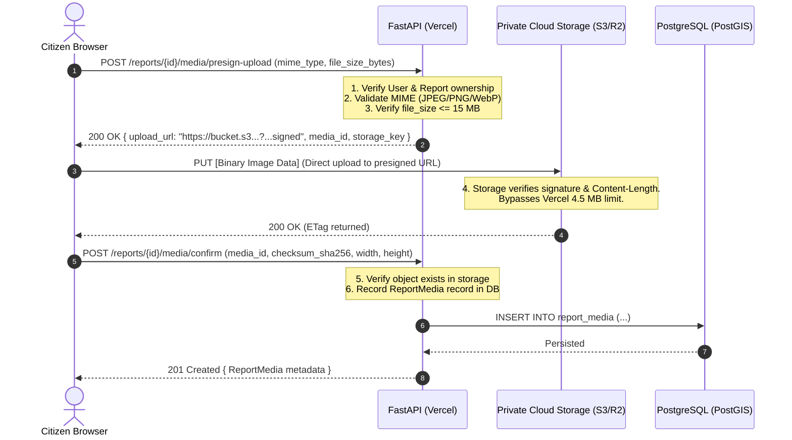

# SafeSpace Intelligence — Vercel Production Deployment & Architecture Guide

This document provides complete technical procedures and architectural specifications for deploying **SafeSpace Intelligence** to Vercel in a decoupled production topology.

---

## 1. Target Production Architecture

```
                   ┌───────────────────────────────────────┐
                   │            Citizen / Staff            │
                   │                Browser                │
                   └──────────────────┬────────────────────┘
                                      │
              ┌───────────────────────┴───────────────────────┐
              │                                               │
              ▼ (HTTPS - SPA)                                 ▼ (HTTPS - API & Auth)
  ┌─────────────────────────┐                     ┌─────────────────────────┐
  │     Frontend Project    │                     │     Backend Project     │
  │     (Vercel Edge CDN)   │                     │ (Vercel Serverless/Py)  │
  │                         │                     │                         │
  │ • React 19 + TypeScript │                     │ • Python 3.12 + FastAPI │
  │ • Vite Bundler          │                     │ • NullPool Engine       │
  │ • MapLibre GL           │                     │ • JWT Stateless RBAC    │
  └─────────────────────────┘                     └───────────┬─────────────┘
                                                              │
                                      ┌───────────────────────┴───────────────────────┐
                                      ▼ (psycopg3 SSL / Port 5432/6543)               ▼ (Presigned URLs / S3 API)
                          ┌─────────────────────────┐                     ┌─────────────────────────┐
                          │   Managed PostgreSQL    │                     │  Cloud Object Storage   │
                          │   (PostGIS 15/16/17)    │                     │  (AWS S3 / R2 / GCS)    │
                          │                         │                     │                         │
                          │ • Neon / Supabase / RDS │                     │ • Ephemeral bypass      │
                          │ • PgBouncer / Pooler    │                     │ • EXIF stripped         │
                          │ • Alembic Schema Head   │                     │ • Private signed URLs   │
                          └─────────────────────────┘                     └─────────────────────────┘
```

- **Frontend Deployment**: Vercel Static/Edge network hosting React 19 + Vite SPA with SPA route rewrite.
- **Backend Deployment**: Vercel Serverless Function running Python 3.12 + FastAPI ASGI (`api/index.py`).
- **Database**: External Managed PostgreSQL with PostGIS extension (e.g., Supabase, Neon, or AWS RDS).
- **File Storage**: Private cloud object storage (AWS S3, Cloudflare R2, or Supabase Storage) using direct-to-storage signed URLs to bypass Vercel's 4.5 MB request body limit.
- **Background Processing**: Synchronous spatial queries & analytics within PostgreSQL/PostGIS. No external Celery or Redis workers required.

---

## 2. Phase 1 — Deployment Audit Summary

| Component | Status | Finding / Action Taken |
|---|---|---|
| **Frontend Root** | Ready | `frontend/` with Vite 8.3, React 19, TypeScript. SPA rewrite rule configured in `frontend/vercel.json`. |
| **Backend Root** | Ready | `backend/` with FastAPI 0.115+. Serverless entry point configured at `backend/api/index.py`. |
| **Dependencies** | Ready | Locked `backend/requirements.txt` generated from `pyproject.toml` via `uv export --no-dev --no-hashes`. |
| **Database Pool** | Ready | Added `NullPool` serverless mode when `VERCEL=1` or `DATABASE_POOL_TYPE="null"` to eliminate connection leakage. |
| **Migrations** | Ready | Head at `0006`. Execution decoupled from serverless cold starts. |
| **Auth / Tokens** | Ready | Stateless Argon2id + HS256 JWT tokens. No server-side session state. |
| **Media Pipeline**| Planned | Local storage incompatible with serverless; direct-to-storage presigned upload plan formulated (Phase 5). |
| **Background Jobs** | Verified | Zero Celery or Redis dependencies. All analytical models run synchronously in PostGIS. |
| **CORS** | Ready | Strict origin whitelisting via `CORS_ORIGINS`. |

---

## 3. Phase 2 — Frontend Deployment Preparation

### 3.1 Vercel Project Setup (Frontend)
1. In Vercel Dashboard, select **Add New Project** -> Import your repository.
2. Configure **Root Directory**: `frontend`.
3. Framework Preset: **Vite**.
4. Build Command: `npm run build` (runs `tsc -b && vite build`).
5. Output Directory: `dist`.

### 3.2 SPA Route Rewrites (`frontend/vercel.json`)
```json
{
  "rewrites": [
    {
      "source": "/(.*)",
      "destination": "/index.html"
    }
  ]
}
```
*Guarantees that direct navigation and deep links to `/login`, `/admin/map`, and `/citizen/reports` resolve cleanly without 404 errors.*

### 3.3 Environment Variables
Set in Vercel Project Settings -> **Environment Variables**:

| Variable Name | Required | Example Value | Description |
|---|---|---|---|
| `VITE_API_BASE_URL` | Yes | `https://api-safespace.vercel.app/api/v1` | Public HTTPS base URL of the deployed backend. |

---

## 4. Phase 3 — Backend Deployment Preparation

### 4.1 Vercel Project Setup (Backend)
1. In Vercel Dashboard, select **Add New Project** -> Import the same repository.
2. Configure **Root Directory**: `backend`.
3. Framework Preset: **Other**.
4. Build & Development Settings: Vercel auto-detects `api/index.py` and `requirements.txt`.

### 4.2 Entrypoint Configuration (`backend/api/index.py`)
```python
import sys
from pathlib import Path

backend_root = Path(__file__).resolve().parent.parent
if str(backend_root) not in sys.path:
    sys.path.insert(0, str(backend_root))

from app.main import app  # Exposes the ASGI application
```

### 4.3 Routing & Runtime (`backend/vercel.json`)
```json
{
  "version": 2,
  "builds": [
    {
      "src": "api/index.py",
      "use": "@vercel/python"
    }
  ],
  "routes": [
    {
      "src": "/(.*)",
      "dest": "api/index.py"
    }
  ]
}
```

### 4.4 Serverless Database Connection Management
Because serverless functions spin up and scale dynamically:
- Standard connection pools (`pool_size=10, max_overflow=20`) can exhaust database slots.
- SafeSpace automatically switches to SQLAlchemy `NullPool` when `VERCEL="1"` or `DATABASE_POOL_TYPE="null"`.
- Each request checks out a fresh connection and closes it immediately upon response termination.

---

## 5. Phase 4 — Database Provisioning & Migration Guide

### 5.1 Managed PostgreSQL Selection Requirements
- **Engine Version**: PostgreSQL 15, 16, or 17.
- **Extensions**: `postgis` (PostGIS 3.3+).
- **Recommended Cloud Providers**:
  - **Supabase**: PostgreSQL 15/16 with PostGIS pre-installed. Provides PgBouncer / Supavisor connection pooler on port 6543.
  - **Neon**: Serverless Postgres with PostGIS. Provides connection pooling on port 5432 via `-pooler` endpoint.
  - **AWS RDS / Aurora**: PostgreSQL with PostGIS extension.

### 5.2 Enabling PostGIS
If using a bare PostgreSQL instance, connect with admin credentials and execute:
```sql
CREATE EXTENSION IF NOT EXISTS postgis;
```

### 5.3 Running Database Migrations
> [!IMPORTANT]
> **Never** execute migrations inside serverless application startup (`lifespan`). Multiple serverless function boots racing to execute DDL will cause table locks and deployment corruption.

Execute migrations out-of-band before routing traffic (from CI/CD or an administrative workstation):

```bash
# Set production DATABASE_URL
export DATABASE_URL="postgresql+psycopg://<user>:<password>@<db-host>:5432/<dbname>?sslmode=require"

# Run Alembic migrations to head (0006)
cd backend
alembic upgrade head
```

Verify migration status:
```bash
alembic current
# Output must show: 0006 (head)
```

---

## 6. Phase 5 — Direct-to-Storage Object Storage Architecture

### 6.1 The Vercel Serverless Constraint
- **Vercel HTTP Body Limit**: Exactly **4.5 MB** for serverless requests.
- **SafeSpace Evidence Policy**: SafeSpace allows high-resolution photographic evidence up to **15 MB**.
- **Ephemeral Filesystem**: Files written to `/tmp` are wiped across cold starts and are never shared between serverless instances.

### 6.2 Target Direct-to-Storage Protocol



### 6.3 Media Download & Access Control
When citizen, verifier, or admin requests image evidence:
- Client calls: `GET /reports/{id}/media/{media_id}`
- FastAPI verifies RBAC authorization (reporter, verifier, admin, or public if report status is `VERIFIED`).
- FastAPI returns a signed presigned GET URL (15-minute TTL) via HTTP `307 Temporary Redirect`.
- Browser loads directly from CDN/Storage with zero egress load on FastAPI.

---

## 7. Phase 6 — Background Processing Audit

- **Audit Finding**: Celery and Redis are **not** present in `backend/app`.
- **Duplicate Detection**: Calculated dynamically via PostGIS spatial indexing (`ST_DWithin`) during verification and reporting queries.
- **SDI & Confidence Aggregation**: Calculated synchronously using SQLAlchemy analytical queries and PostGIS geometry unions.
- **Conclusion**: No standing background workers, Celery daemons, or Redis clusters are required for this deployment.

---

## 8. Phase 7 — Production Configuration Reference

### Backend Environment Variables (`backend/.env.production.example`)
```bash
APP_NAME="SafeSpace Intelligence"
APP_ENV="production"
DEBUG=false
API_V1_PREFIX="/api/v1"

# Security (min 32 characters)
SECRET_KEY="<64-hex-char-secret>"
JWT_SECRET_KEY="<64-hex-char-secret>"
JWT_ALGORITHM="HS256"
ACCESS_TOKEN_EXPIRE_MINUTES=60
REFRESH_TOKEN_EXPIRE_DAYS=7

# Database (PostgreSQL + PostGIS)
DATABASE_URL="postgresql+psycopg://<user>:<password>@<pooler-host>:5432/<dbname>?sslmode=require"
DATABASE_POOL_TYPE="null"

# CORS
CORS_ORIGINS='["https://safespace-frontend.vercel.app"]'

# Storage
MEDIA_STORAGE_PROVIDER="s3"
MEDIA_STORAGE_BUCKET="safespace-media-production"
MEDIA_STORAGE_PATH="uploads/media"
```

### Frontend Environment Variables (`frontend/.env.production.example`)
```bash
VITE_API_BASE_URL="https://safespace-backend.vercel.app/api/v1"
```

---

## 9. Verification & Rollback Procedures

### 9.1 Verification Checklist
- [ ] Root health check responds: `GET /health` -> `{"status": "healthy"}`
- [ ] Database connectivity verified: `GET /api/v1/health/database` -> `{"status": "healthy", "database": "reachable"}`
- [ ] Authentication: Log in as Citizen, Verifier, and Admin.
- [ ] Report submission: Citizen can submit report; PostGIS spatial geometry is created.
- [ ] Moderation queue: Verifier can access pending queue and verify reports.
- [ ] Analytics & SDI: Admin can inspect SDI heatmaps and confidence scores.
- [ ] Deep links: Refresh browser at `/admin/map` and verify React Router SPA routing does not 404.

### 9.2 Rollback Plan
1. **Frontend**: In Vercel Project Dashboard -> **Deployments** -> Locate previous stable deployment -> Click `...` -> **Promote to Production**. Instant zero-downtime rollback.
2. **Backend**: In Vercel Backend Project -> **Deployments** -> Locate previous deployment -> **Promote to Production**.
3. **Database**: If a database schema downgrade is strictly necessary:
   ```bash
   alembic downgrade -1
   ```
